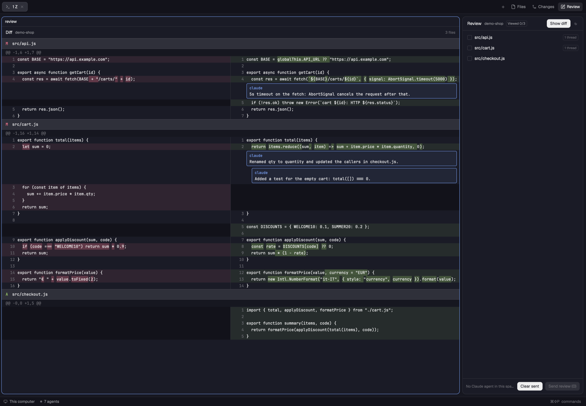

# Agent Review — a Herdr mod

GitLab-style code review of the uncommitted changes in a git repo, of one commit of your branch, or of everything committed on the branch, made for reviewing what a Claude Code agent just wrote. A side panel lists the changed files as a folder tree; a tab of its own shows a side-by-side diff with syntax colors and word-level highlights, inline comment threads and a "Viewed" checkbox per file, which folds the files you have checked, like on GitLab. "Send review" sends every unsent comment to the space's Claude Code agent as one message, and the agent's replies show up under the same lines.



## Requirements

- [Herdr](https://herdr.dev) desktop app.
- `git` and a POSIX `sh` with `xargs` on the machine the repo is on (this one, or a machine added to Herdr).
- A Claude Code agent running in the same Herdr space, to receive the review.
- `jq` on the agent's machine: the agent uses it to post its replies.

## What it runs

Read this before installing. The mod:

- runs `git`, `sh`, `xargs`, `herdr-app do …` (to open and show its diff tab) and `hc send` (to send the review to the agent);
- reads and empties `<repo>/.git/herdr-review.jsonl`, the file the agent appends its replies to;
- stores comments and "Viewed" marks in Herdr's shared state (`~/.config/herdr-app/shared.json`);
- makes no network requests.

## Install

### With your Herdr agent

In Herdr, ask an agent: *"Install the Herdr mod from https://github.com/fgiova/herdr-agent-review"*. Herdr's `AGENTS.md` tells it how to copy the mod, check it and add it to your layout.

### By hand

1. Copy the mod into Herdr's home. If you already have a mod called `agent-review`, pick another folder name.

   ```sh
   git clone https://github.com/fgiova/herdr-agent-review.git /tmp/herdr-agent-review
   cp -R /tmp/herdr-agent-review/mods/agent-review ~/.config/herdr-app/mods/agent-review
   herdr-app check ~/.config/herdr-app/mods/agent-review
   ```

2. Add the panel to your layout. Herdr's shipped layouts are read-only, so if you are on the default `main` layout, clone it first (this also switches to the clone):

   ```sh
   herdr-app do layout.clone '{"name":"main","as":"my-main"}'
   ```

   In `~/.config/herdr-app/layouts/my-main.json`, find the `panel-body` stack (it holds the Files and Changes panels) and add a third child:

   ```json
   { "id": "agent-review", "type": "block", "content": { "mod": "agent-review" } }
   ```

   Then run `herdr-app status`: the `errors` list must be empty (a broken layout is reported in `layouts/my-main.error`).

3. Show the panel:

   ```sh
   herdr-app do layout.select '{"stack":"panel-body","child":"agent-review"}'
   herdr-app do layout.show --id panel
   ```

4. Optional: a key to toggle the panel. Add it to `~/.config/herdr-app/keys.json`:

   ```json
   { "global": { "cmd-shift-r": "layout.toggle:panel" } }
   ```

   It toggles whichever panel was shown last (Files, Changes or Agent Review).

## Use

1. In a space whose terminal is inside a git repo with uncommitted changes, show the Agent Review panel and click **Open diff**: the diff opens in a new tab, `Review <repo>`. The panel keeps showing that repo while you are in the tab; from another tab, **Show diff** takes you back to it.
2. To review what is already committed, open the picker under the panel header (it says **Local changes**):
   - **All branch changes** shows everything committed on the branch since it left the default branch (`origin/HEAD`, else `main` or `master`), like a merge request;
   - below it are the branch's commits (at most 50; on the default branch, its latest 50): pick one to review only that commit.

   The panel and the diff switch together. Each choice has its own comments and Viewed marks, and the message to the agent says which commit or branch it is about.
3. Tick **Viewed** at the right of a file's header to fold it and mark it in the panel. Click elsewhere on a header to fold or unfold that file.
4. Click a line to comment on it; `ctrl-s` saves, `esc` cancels. Right-click comments on the side under the pointer.
   - To comment on several lines, click the **+** at the left of a line number to start, then the **+** of another line on the same side to stretch the selection to it. Shift-click and `shift-↑`/`shift-↓` do the same. A **+** at either end of the selection drops that line; on a single selected line it closes the comment.
   - The selected lines are highlighted; the comment sits under the last one and is sent to the agent as `file:12-18` together with the selected code.
5. Click a comment to select it: `r` replies, `e` edits, `d` deletes.
6. **Send review (N)** sends all unsent comments to the space's Claude Code agent. When the space has several, pick one from the chips in the panel footer.
7. The agent replies by appending a line to `.git/herdr-review.jsonl` (the message includes the exact `jq` command); replies appear under their threads within seconds.
8. **Clear sent** removes the threads you sent and the agent answered.

Comments and "Viewed" marks are kept per repo and per choice in the picker, and survive restarts. A file's "Viewed" mark clears when its diff changes.

## Limits

- Repos on another machine refresh every 10 seconds instead of on file changes.
- Up to 1500 diff lines per file, about 9000 rows for the whole diff, and 4000 characters per line. On a larger diff the rest of each file is hidden behind a "… more lines not shown" line: double-click the file in the panel to view it alone. Comments on hidden lines are listed at the end of their file. Word highlighting is off for lines with more than 400 tokens per side.
- Syntax colors come from your theme and are picked by file extension: JS/TS and the other C-family languages, PHP, Python, Ruby, shell, SQL, GraphQL, CSS, JSON, YAML, TOML, HTML/XML/Vue and Markdown; other files are shown plain. It is a light highlighter, not a full parser: strings spanning several lines (template literals, heredocs, triple quotes) are colored only on their first line, and code nested in another language (scripts and styles in HTML or Vue) isn't colored.
- File paths that git quotes (unusual characters) aren't parsed.
- Comments are re-anchored by exact text match: after an edit, threads whose line changed are listed at the end of their file. A range is re-anchored by its last line; its `lines a–b` label keeps the original numbers.
- A commit's comments refer to that commit's line numbers, not to the current files. A commit that no longer exists (after a rebase) shows a git error: pick another view.
- Selections are whole lines, made with clicks or keys: Herdr doesn't report pointer drags over diff rows, so dragging across lines doesn't select them. The code sent with a range stops at 80 lines.

## Update

Herdr doesn't update mods by itself. Each version is a [GitHub release](https://github.com/fgiova/herdr-agent-review/releases) with its notes, and its number is in `mods/agent-review/mod.json` (`"version"`). To hear about new ones, use **Watch → Custom → Releases** on this repository.

To update, replace the mod's files in place. Herdr reloads the mod at once; your layout, keys, comments and Viewed marks stay as they are.

```sh
git clone https://github.com/fgiova/herdr-agent-review.git /tmp/herdr-agent-review
cp /tmp/herdr-agent-review/mods/agent-review/* ~/.config/herdr-app/mods/agent-review/
herdr-app check ~/.config/herdr-app/mods/agent-review
```

Or ask your Herdr agent: *"Update my installed agent-review mod in place from https://github.com/fgiova/herdr-agent-review"*. Say "in place": by default an agent installs a mod under a new name rather than overwrite one you have.

## Uninstall

Remove `~/.config/herdr-app/mods/agent-review`, the `agent-review` block from your layout and the key from `keys.json`.

## Development

`node mods/agent-review/diff.js` and `node mods/agent-review/highlight.js` run the self-tests of the diff parser and the syntax highlighter; each prints `ok`. [`RECIPE.md`](RECIPE.md) describes the mod in full, so it can be rebuilt from scratch.

## License

[MIT](LICENSE)
