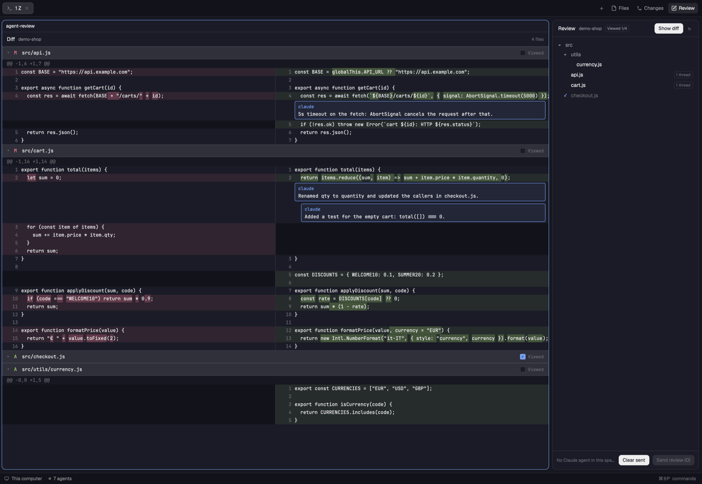

# Agent Review

A GitLab-style code review of the uncommitted changes in a git repo, made for reviewing what a Claude Code agent just wrote. A side panel lists the changed files as a folder tree; a pane opens next to the terminals with a side-by-side diff where changed words are highlighted, each file has a "Viewed" checkbox and viewed files fold away like on GitLab, comments sit inline under the lines as threads, and "Send review" sends every unsent comment to the space's Claude Code agent as one message. The agent answers each thread by appending a line to a file in `.git`, and its replies show up under the same lines.

## What you see

**Side panel** (a layout block, ~368px wide in the author's layout, rounded 10px, `t.background`, 1px `t.border`):
- Header, 42px: "Review" semibold, the repo folder name in `t.muted` 11px, a `Viewed x/y` tag, then on the right a solid button "Open diff" (or "Show diff" when the pane already exists in the space) and a `↻` refresh glyph.
- File list (scrolls): a folder tree of the changed files and the files that still have threads, folders first, then by name, indented 14px per level. A folder row is 24px in `t.muted`: a `▾`/`▸` glyph and the folder name. A file row is 26px: a 12px column with an accent `✓` when viewed, the file name (dimmed once viewed), then tags 10px with a 1px border: `only this` (accent) when the diff is narrowed to this file, `N unsent` (`t.blocked`) for unsent comments, else `N threads` (dim). The last clicked file gets `t.selected`.
- Status line when there's nothing to list: "Not a git repository", "No repository", "Loading…", "No changes".
- Footer: when the space has more than one Claude Code agent, a chip per agent (`<tab name> · <address>`, accent border on the chosen one); a line `→ <tab> (<address>)` or "No Claude agent in this space"; buttons "Clear sent" and "Send review (N)" (disabled with no agent or nothing to send, "Sending…" while sending); under them a one-line note (dim on success, `t.blocked` on error).

**Diff pane** (a mod pane split to the right, zoomed and focused):
- Header, 36px: "Diff", the repo name, a `only <file>` accent tag when narrowed, `N files` on the right.
- One virtual list in the terminal font (`settings().font_family`, 12px):
  - File header 32px on `t.raised`, top/bottom border: a dim `▾` (open) or `▸` (folded), a status letter (A `t.ansi2`, D `t.ansi1`, R `t.accent`, M `t.blocked`), the path (`old → new` for renames), `binary` tag, and at the right end a 14px checkbox (filled `t.accent` with ✓ when viewed) with a dim 11px "Viewed". A folded file shows only its header.
  - Hunk header 22px on `t.canvas`, dim `@@ … @@` text.
  - Line rows 20px, two equal columns split by a 1px `t.border` line. Each column: a 40px right-aligned dim line number, then the text. Removed lines `t.ansi1` at 0x18 alpha on the left, added `t.ansi2` at 0x18 on the right, context on `t.background` both sides, the empty side of an unpaired line on `t.chrome`. When a removed line is paired with an added one, the changed words get a stronger 0x40 alpha of the same color.
  - Threads under the line they're anchored to, in that line's column (old left, new right), indented 48px, replies 16px more. Each comment is a rounded box: a header line with the author ("you" for the user, else the agent's name), `unsent` in `t.blocked` if unsent, and when selected the key hints on the right; then the text wrapped to the column. User comments on `t.raised` with `t.border`; agent comments with a `t.accent` border and accent-tinted background; the selected one with a `t.foreground` border on `t.selected`.
  - The comment box being written: accent border, a hint line ("New comment, line N", "Reply" or "Edit" · "cmd-enter save · esc cancel") and a 4-row textarea.
  - Threads whose line is gone go under "Comments no longer anchored to the diff" at the end of their file, or under "Comments on files no longer in the diff" at the end.

## How it behaves

- The panel follows the focused pane's folder; with the diff pane focused it uses a terminal of the same tab. Outside a git repo it says so.
- "Open diff" splits the focused pane to the right with the diff, zooms and focuses it; "Show diff" zooms and focuses the existing one.
- Clicking a file scrolls the diff to it (opening/showing the pane). If the diff is narrowed to another file, the narrowing moves to this one. Double-click narrows the diff to that file, again shows all files. Clicking a folder folds or unfolds it (not kept across restarts).
- In a diff file header, a click on the right 90px (the Viewed checkbox) toggles Viewed; Viewed stays until that file's diff changes. Viewed files start folded; a click elsewhere on the header folds or unfolds the file, and that choice holds until its Viewed state changes.
- Both views refresh when files in the repo change (folder watch) and every 10s; the diff is re-parsed only when git's output changed.
- In the diff: click a line to comment on its new side (old if it only has an old side); right-click picks the side under the pointer. `cmd-enter` saves, `esc` cancels; one comment box at a time.
- Click a comment to select it; with it selected `r` replies, `e` edits and `d`/`backspace` deletes (whole thread if it's the first comment). Edit and delete only for the user's own comments; agent notes can only be replied to. A second click on the selected comment replies. `esc` clears the selection.
- "Send review (N)" sends one message, grouped by file, with each thread as `- file:line [thread <id>] — text` and its replies, followed by the exact `jq` commands the agent runs to reply. It goes to the chosen agent (or the focused one, else the one in the active tab, else the most recent) with `hc send`; the comments then count as sent. Messages over 50 KB aren't sent.
- Agent replies: lines appended to `<git-dir>/herdr-review.jsonl` are merged into the threads within seconds and the file is emptied. A reply carries `parentId`; a new note carries `file`, `side`, `line`.
- "Clear sent" removes the threads where every user comment was sent and the agent has answered.
- A new HEAD (commit, checkout) drops the threads on files no longer in the diff, and the narrowing if its file is gone.
- Comments, Viewed and the narrowing are kept per repo and survive restarts.
- No agent statuses are shown: the panel only looks for Claude Code agents (`app === "claude-code"`) with a pane in the shown space.

## Built from

- Files: `mods/agent-review/main.js` (one `View` class with two views), `mods/agent-review/diff.js` (pure functions), `mod.json` `{ "place": "none", "title": "Agent Review" }`.
- Layout: a block `{ "mod": "agent-review" }` with no props is the panel. The author keeps it as the third child of a `stack` (`panel-body`) inside a `column` node `panel`, next to the shipped `files` and `changes`, and toggles it with `layout.select {stack: "panel-body", child: "review"}` + `layout.show {id: "panel"}`.
- The diff pane: `pane.split {direction: "right", pane, mod: "agent-review", props: {view: "diff", root}}` through `exec("herdr-app", ["do", …])` to get its id back, then `pane.zoom` and `pane.focus`. `init` reads `props()` from `herdr` and shows the diff when `view === "diff"`.
- Git, in one `sh -c` per refresh: `B=$(git rev-parse -q --verify HEAD || git hash-object -t tree /dev/null)`, echo `$B` (the HEAD for pruning), `git diff $B`, then `git ls-files -z -o --exclude-standard | xargs -0 -n1 git diff --no-index -- /dev/null` for untracked files. All with `--no-optional-locks -c core.fsmonitor=false -c diff.autoRefreshIndex=false`, `--no-color --no-ext-diff --no-textconv`.
- `diff.js`: `parseUnified` (files with status, rename, binary, the `index a..b` line, blocks of rows with line numbers), `pairSplit` (runs of `-` then `+` paired 1:1), `wordDiff` (LCS over `\w+|\s+|[^\w\s]` tokens, merged segments), `anchor` (re-anchoring), `mergeAgent` (JSONL into the store), `reviewMessage`. `node diff.js` runs its asserts.
- State: `shared("review:<repo root>") = { comments, viewed, scope, head }`. A comment is `{ id, source: "user"|"agent", author, file, side: "old"|"new", line, text, at, parentId, sent, ctx? }`; `viewed[path]` is the file's `index a..b` line. `shared("review.goto") = { root, file, n }` tells the pane where to scroll.
- `herdr` functions: `spaces`, `panes`, `agents`, `focused`, `exec`, `theme`, `shared`/`setShared`, `settings`, `props`, `watchFolder`, `readTextFile`, `writeTextFile` (with the expected old text). gpui-base: `v_virtual_list` with per-item sizes, `VirtualListScrollHandle`, `Scrollbar`, `Textarea`/`TextareaState`.
- Programs: `git`, `sh`, `xargs`, `herdr-app do`, `hc send`; the agent needs `jq`.
- No art.

## Watch out

- Pane props come from `props()`, not from `init`'s argument: reading `init(props)` makes the pane a second copy of the panel.
- Event handlers inside virtual list items don't work: use the list's `on_item_click` / `on_item_secondary_click` and work out the item from its key; keys go to the list container via `track_focus` + `on_key_down`. To tell a click on the header's Viewed checkbox from one on the rest of the header, an `on_mouse_down` on the list's container records whether the pointer was in the right 90px, and `on_item_click` reads it.
- Every item needs its height in the sizes array up front, so comment text is wrapped in JS at an estimated 7.2px per character of the column width (`on_size_change`).
- Clicking a comment must not open the textarea right away, or the textarea takes the keys and `e`/`d` never reach the list.
- Focus the textarea after a short sleep (~50ms), once the item exists.
- The panel and the pane both write the store and both read the JSONL: re-read the store right before every write, dedup agent lines by id (lines without an id get a hash of the line), and empty the file with `writeTextFile(path, "", raw)` so lines appended meanwhile aren't lost.
- Git must not write under `.git` (the flags above), or the folder watch wakes itself forever.
- The pane must stay on its own repo (`props.root`); the panel's repo changes with focus, so drop stale results when the repo changed during a refresh.
- A mod only starts once shown: a pane opened in a hidden space does nothing until you go there.
- Limits: diff rows capped at 1500 per file, lines at 4000 characters; word diff off above 400 tokens per side; quoted git paths (unusual characters) aren't parsed; re-anchoring is an exact text match only; the JSONL channel works for local repos only; no limit on untracked files.
- The author opens the panel from a "Review" tab-bar button and `cmd-shift-r` in a cloned tabs mod; that toggle also closes the space's `agent-review` panes (`panes().filter(p => p.mod === "agent-review")` → `pane.close`) and brings back the panel it covered. Without it, show the block with `layout.select` / `layout.show`.

## Done when

- `herdr-app check mods/agent-review` passes and `node mods/agent-review/diff.js` prints `ok`.
- In a repo with a commit, changing one word of a line shows the line paired across both columns with only that word highlighted on each side; a new untracked file shows as A with an empty left column.
- "Open diff" opens a split pane that is zoomed and focused; clicking a file in the panel scrolls the pane to it; double-click shows only that file.
- Clicking a line, typing and `cmd-enter` adds a comment under it, marked `unsent`, and the panel shows `1 unsent`; `r`, `e`, `d` reply, edit and delete it.
- Ticking Viewed in a file's diff header folds the file and puts a ✓ by it in the panel; Viewed survives a restart and clears (unfolding the file) after that file is edited again.
- Running the `jq` reply command from the sent message adds an accent-styled agent reply under the thread and empties `.git/herdr-review.jsonl`.
- After committing a file, its threads disappear within 10s.
